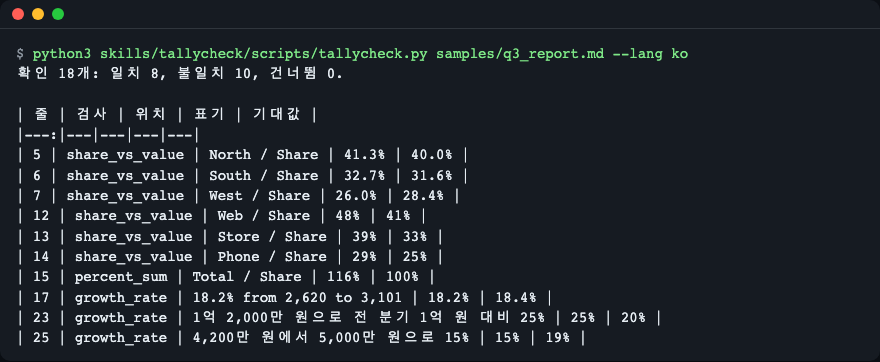
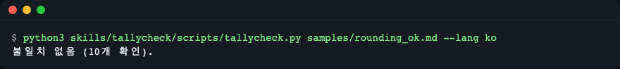
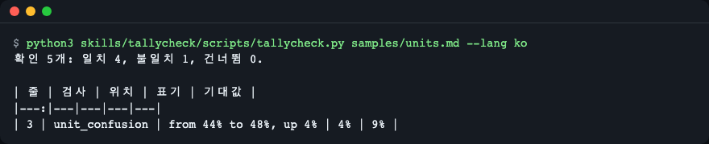
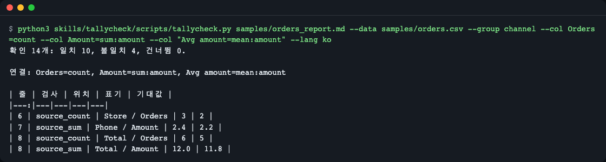
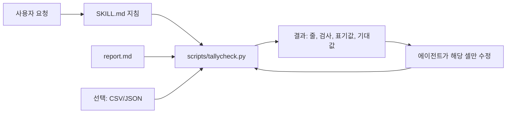

# tallycheck

[English](README.md) | **한국어**

마크다운 보고서의 숫자(표 합계·구성비·평균·증감률·%p)를 동봉된 Python 스크립트로 다시 계산해, 에이전트가 정말 틀린 셀만 고치게 해 주는 에이전트 스킬입니다. 원하면 표 셀을 CSV/JSON 원자료와 대조합니다.


*틀린 숫자마다 줄 번호, 실패한 검사, 적힌 값, 대신 써야 할 값을 보여 줍니다.*

## 하는 일
- **반올림을 고려한 구간 산술로 재계산합니다.** 보이는 숫자는 마지막 자리 반 단위만큼의 구간으로 봅니다. 그래서 `33.3%` 세 줄에 합계 `99.9%` 는 통과하고, `40.0%` 여야 할 `41.3%` 는 걸립니다.
- **자주 틀리는 주장을 검사합니다:** 합계·소계 행(이중 계산 없음), 합계 열, 100% 가 되어야 하는 구성비, 구성비 = 값 / 합계, 평균 행, 문장 속 증감률("2,620에서 3,101로 18.2% 증가"), %p, 그리고 % 와 %p 혼동. 영어·한국어 문장과 숫자 표기(`1억 2,000만`, `1.2억`, `k`/`M`)를 이해합니다.
- **원자료와 대조합니다**(`--data`, `--group`, `--col`): 행 이름별 개수·합계·평균·비중을 CSV 또는 JSON 과 비교합니다.
- **정직하게 동작합니다:** `1.234,56` 처럼 모호한 숫자는 추측하지 않고 건너뜀으로 표시합니다. tallycheck 는 보고서를 읽기만 하고 다시 쓰지 않으며, 저장하는 결과는 스크립트의 `--out` 출력입니다.
- 표준 라이브러리만 쓰고 네트워크·API 키가 필요 없습니다. 출력은 마크다운 또는 JSON, 종료 코드는 0(일치), 1(불일치), 2(입력 오류)입니다.

## 설치
**Claude Code**
```
/plugin marketplace add LeeGyeongPil/tallycheck
/plugin install tallycheck@tallycheck-skill
```
**Codex CLI 등 Agent Skills 표준을 읽는 에이전트** — `skills/tallycheck` 폴더를 에이전트의 스킬 폴더(예: 프로젝트의 `.agents/skills/`)에 복사합니다.

Python 3.10 이상이 필요합니다(`python3 --version`). 따로 설치할 패키지는 없습니다.

에이전트 없이 스크립트만 실행할 수도 있습니다:
```
git clone https://github.com/LeeGyeongPil/tallycheck && cd tallycheck
python3 skills/tallycheck/scripts/tallycheck.py samples/q3_report.md --lang ko
```

## 사용법
에이전트에게 평소 말투로 요청하면 됩니다. 예:

- "보내기 전에 `report.md` 의 숫자를 한 번 더 확인해 줘."
- "이 표의 구성비 합이 맞는지, 증감률도 같이 봐 줘."
- "`orders_report.md` 의 표를 `orders.csv` 와 맞춰 봐 줘."
- (영어도 됩니다) "Double-check the figures in this report"

에이전트는 스크립트를 돌려 불일치를 알려 줍니다. 직접 실행하려면(`samples/q3_report.md` 에는 오류 10개가 심겨 있고, 아래 출력은 이 명령의 실제 결과이며 종료 코드는 1입니다):

```
$ python3 skills/tallycheck/scripts/tallycheck.py samples/q3_report.md --lang ko
확인 18개: 일치 8, 불일치 10, 건너뜀 0.

| 줄 | 검사 | 위치 | 표기 | 기대값 |
|---:|---|---|---|---|
| 5 | share_vs_value | North / Share | 41.3% | 40.0% |
| 6 | share_vs_value | South / Share | 32.7% | 31.6% |
| 7 | share_vs_value | West / Share | 26.0% | 28.4% |
| 12 | share_vs_value | Web / Share | 48% | 41% |
| 13 | share_vs_value | Store / Share | 39% | 33% |
| 14 | share_vs_value | Phone / Share | 29% | 25% |
| 15 | percent_sum | Total / Share | 116% | 100% |
| 17 | growth_rate | 18.2% from 2,620 to 3,101 | 18.2% | 18.4% |
| 23 | growth_rate | 1억 2,000만 원으로 전 분기 1억 원 대비 25% | 25% | 20% |
| 25 | growth_rate | 4,200만 원에서 5,000만 원으로 15% | 15% | 19% |
```

**정당한 반올림은 오류가 아닙니다.** `33.3%` 세 줄과 합계 `99.9%`, `1.4 + 1.4 = 2.9`, 평균 `1,033.7`(3,101 / 3), "1,000에서 1,190으로 약 20%" 는 모두 통과합니다:

```
$ python3 skills/tallycheck/scripts/tallycheck.py samples/rounding_ok.md --lang ko
불일치 없음 (10개 확인).
```

*고칠 것이 없으니 에이전트는 숫자를 그대로 둡니다.*

**% 와 %p 혼동.** "44%에서 48%로 4% 상승"은 걸립니다(상대 변화는 9%). "4%p 상승"은 통과합니다:

```
$ python3 skills/tallycheck/scripts/tallycheck.py samples/units.md --lang ko
확인 5개: 일치 4, 불일치 1, 건너뜀 0.

| 줄 | 검사 | 위치 | 표기 | 기대값 |
|---:|---|---|---|---|
| 3 | unit_confusion | from 44% to 48%, up 4% | 4% | 9% |
```

*%p 차이를 뜻했다면 `4%p` 로 쓰라는 안내가 메시지에 들어 있습니다.*

**원자료와 대조.** `--group` 은 표의 행 이름이 들어 있는 데이터 열, `--col 머리글=count|sum:필드|mean:필드|share:필드` 는 표 머리글을 집계에 연결합니다:

```
$ python3 skills/tallycheck/scripts/tallycheck.py samples/orders_report.md --data samples/orders.csv --group channel --col Orders=count --col Amount=sum:amount --col "Avg amount=mean:amount" --lang ko
확인 14개: 일치 10, 불일치 4, 건너뜀 0.

연결: Orders=count, Amount=sum:amount, Avg amount=mean:amount

| 줄 | 검사 | 위치 | 표기 | 기대값 |
|---:|---|---|---|---|
| 6 | source_count | Store / Orders | 3 | 2 |
| 7 | source_sum | Phone / Amount | 2.4 | 2.2 |
| 8 | source_count | Total / Orders | 6 | 5 |
| 8 | source_sum | Total / Amount | 12.0 | 11.8 |
```

*CSV 와 다른 셀이 4개이고 Web 행은 일치합니다.*

옵션: `--format md|json`, `--out 경로`(결과를 파일에 쓰고 한 줄 요약만 출력), `--exit-zero`(불일치가 있어도 종료 코드 0), `--lang en|ko`. 초안 표나 문장을 건너뛰려면 바로 앞 줄에 `<!-- tallycheck:ignore -->` 를 넣습니다.

결과 저장: 에이전트에게 결과를 파일로 저장해 달라고 하면 파일을 직접 쓰지 않고 스크립트의 `--out` 으로 만듭니다(예: `python3 skills/tallycheck/scripts/tallycheck.py samples/q3_report.md --lang ko --out result.md`). 불일치 목록은 채팅 답변에 적습니다.

출력 언어: `--lang en|ko`, 없으면 `TALLYCHECK_LANG`, 그다음 `LC_ALL` / `LC_MESSAGES` / `LANG`(`ko` 로 시작하면 한국어, 아니면 영어). JSON 키와 검사 코드는 언어와 무관합니다.

## JSON 출력
`--format json` 은 스크립트·CI 용입니다. 줄여 쓴 예(`samples/units.md`, 종료 코드 1):

```
$ python3 skills/tallycheck/scripts/tallycheck.py samples/units.md --format json --lang ko
{
  "tool": "tallycheck",
  "version": "0.1.3",
  "files": ["samples/units.md"],
  "summary": { "checked": 5, "ok": 4, "mismatches": 1, "skipped": 0 },
  "findings": [
    {
      "file": "samples/units.md",
      "line": 3,
      "check": "unit_confusion",
      "status": "mismatch",
      "table": null,
      "row": null,
      "column": null,
      "stated": "4%",
      "expected": "9%",
      "exact": "9.0909",
      "interval": ["6.7416", "11.4943"],
      "message": "..."
    }
  ],
  "skipped": [],
  "mapped": []
}
```
- `stated`: 보고서에 적힌 숫자. `expected`: 보고서가 쓰는 자릿수로 반올림한 올바른 값.
- `exact`: 반올림 전 재계산 값. `interval`: 적힌 숫자가 반올림 후 가질 수 있는 값의 범위로, 이 안에 들어오면 `ok` 입니다.
- `status`: `ok` 또는 `mismatch`. `check`: 검사 코드(`total_row`, `share_vs_value`, `percent_sum`, `growth_rate`, `pp_change`, `unit_confusion`, `source_count`, `source_sum` 등). `line`: 보고서의 줄 번호. `message`: 선택한 언어의 사람이 읽는 설명.
- `table`, `row`, `column`: 표 셀의 위치(문장이면 `null`). `files` 는 입력 파일 목록.
- `skipped` 는 모호해서 판정하지 않은 숫자, `mapped` 는 `--col` 연결입니다. `findings` 에는 `ok` 도 모두 들어갑니다(위 예는 첫 항목만 남긴 것).

## 검증 결과
<!-- skill-eval:start -->
| 확인 | 결과 |
|---|---|
| 필요할 때 불림 | 12/12 |
| 필요 없을 때 안 불림 | 10/10 |
| 스킬로 푼 작업 | 6/6 |
| 스킬 없이 푼 작업(기준선) | 0/6 |
| 평균 점수 차이(Δ) | +0.73 |
| 가짜 스크립트를 잡아낸 비율 | 6/6 |
| Codex CLI | 작업 6/6 통과 · 확인됨 |

Claude Code 2.1.322 · sonnet · 케이스마다 3회 · 2026-11-16 측정 · codex-cli 0.154.0
<!-- skill-eval:end -->

## 동작 방식

에이전트가 `SKILL.md` 를 읽고 보고서(와 선택적으로 데이터 파일)에 스크립트를 실행해 결과를 읽습니다. 틀린 셀만 고친 뒤 종료 코드가 0 이 될 때까지 다시 실행합니다. 스크립트는 지정한 파일만 읽고, `--out` 을 주면 그 파일만 쓰며, 네트워크를 쓰지 않고 `python3` 실행 외의 권한이 필요 없습니다. 검사별 설명과 허용 오차 규칙은 `skills/tallycheck/references/checks.md` 에 있습니다.

**프롬프트가 아니라 스크립트인 이유:** 모델이 자기 보고서를 다시 읽으면 스스로 동의하거나 정당한 `99.9%` 를 "고치기" 쉽습니다. 스크립트는 매번 같은 방식으로 계산하고 반올림 규칙을 알며, 에이전트에게 고칠 줄과 값을 정확히 알려 줍니다.

검사하지 않는 것: PDF, 스프레드시트, HTML 표, 이미지 속 숫자, 의미·인과, 외부 사실, 가중 평균, 복리 성장률.

## 언제 쓰나
- 잘 맞는 경우: 에이전트가 쓴 데이터 요약·분석 메모를 넘기기 직전, 또는 보고서 표가 CSV 내보내기와 일치해야 할 때, 방금 만든 보고서에서 틀린 숫자를 찾아 고칠 때.
- 글자 교정이나 표 서식 정리는 대상이 아닙니다. 문장·모양이 아니라 숫자만 검사합니다.
- 작은 정수는 반올림 구간이 넓어(`2` 두 줄의 합은 3~5 어느 것이든 가능) 짧은 정수 열의 한 군데 오류는 반올림과 구별되지 않습니다.
- 스프레드시트·차트 제작, 엑셀 수식 수정, 외부 자료 대조 팩트체크에는 다른 도구를 쓰세요. 이 스킬은 글에 이미 있는 숫자만 다시 계산합니다.

## 대안
다른 방법도 있습니다. 현재 동작은 각 페이지에서 확인하세요.
- [andon-verify](https://github.com/gulmezeren2-byte/andon): 소스와 검사를 YAML 에 선언한 뒤 CLI 를 실행합니다. 검토된 고정 검사 묶음이 필요할 때 맞고, tallycheck 는 보고서 문장에서 주장을 바로 읽어 냅니다.
- [numaudit](https://github.com/tsurutanmen/numaudit): 문서 속 숫자가 데이터 파일에 나타나는지 확인합니다. tallycheck 는 합계·구성비·증감률을 다시 계산합니다.
- [VisiMark](https://www.obsidianstats.com/plugins/visimark): 마크다운 안에 공식 블록을 적습니다. tallycheck 는 보고서에 따로 표기를 넣을 필요가 없습니다.
- 지시문만 있는 스킬(모델에게 계산을 다시 확인하라고 하는 프롬프트): 실행되는 스크립트가 없어, 검사의 신뢰도가 모델 자신의 암산과 같습니다.

## 개발
```
uv sync && uv run pytest -q
```
`evals/` 에는 발동·비발동 프롬프트와, 스크립트 출력의 정확한 값을 채점하는 작업 케이스가 있고 `tests/test_eval_set.py` 가 채점기를 실제 스크립트 출력에 돌려 봅니다. 각 케이스는 `prompt.md` 와 `graders/` 가 든 폴더입니다.

## 라이선스
MIT
