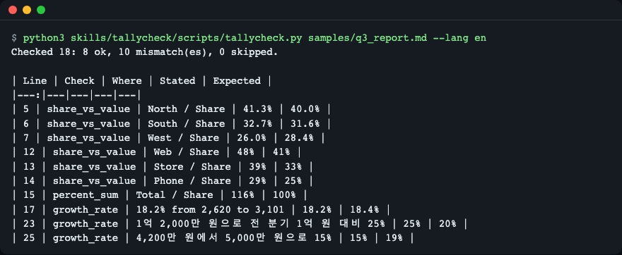
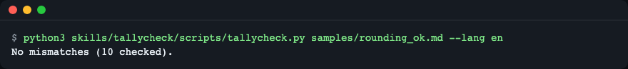
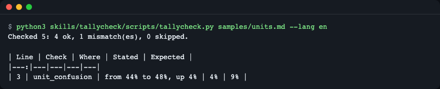
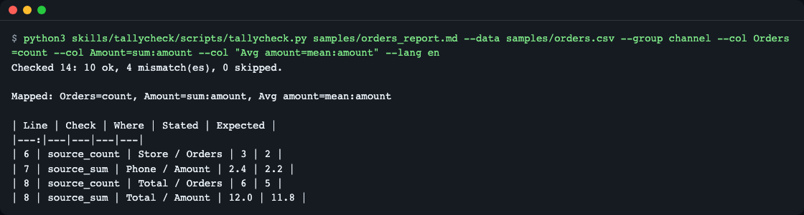
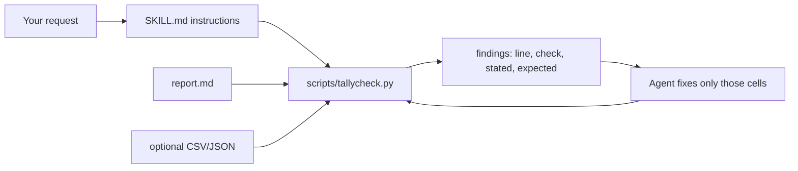

# tallycheck

**English** | [한국어](README.ko.md)

An agent skill that recomputes the numbers in a markdown report (table totals, shares, averages, growth rates, percentage points) with a bundled Python script, so the agent fixes only the cells that are really wrong. Optionally it reconciles table cells with a CSV/JSON source.


*The script lists each wrong number with its line, the check that failed, what is written and what to write instead.*

## What it does
- **Recomputes with rounding-aware intervals.** Every shown number stands for half a unit of its last digit in each direction, so three rows of `33.3%` with a total of `99.9%` pass, while a `41.3%` that should be `40.0%` does not.
- **Checks the usual claims:** Total and Subtotal rows (no double counting), Total columns, shares that must add up to 100%, share = value / total, Average rows, growth rates in sentences ("grew 18.2% from 2,620 to 3,101"), percentage points, and percent vs percentage-point confusion. English and Korean sentences and number styles (`1억 2,000만`, `1.2억`, `k`/`M`) are understood.
- **Reconciles with source data** (`--data`, `--group`, `--col`): counts, sums, means and shares per row label against a CSV or JSON file.
- **Stays honest:** ambiguous numbers such as `1.234,56` are listed as skipped, never guessed. tallycheck only reads your report and never rewrites it; saved results come from the script's own `--out`.
- Standard library only, no network, no API keys. Output is markdown or JSON with exit code 0 (consistent), 1 (mismatches) or 2 (bad input).

## Install
**Claude Code**
```
/plugin marketplace add LeeGyeongPil/tallycheck
/plugin install tallycheck@tallycheck-skill
```
**Codex CLI and other agents that read the Agent Skills standard** — copy `skills/tallycheck` into the skills folder (for example `.agents/skills/` in a project).

Requires Python 3.10 or newer (`python3 --version`). No packages to install.

You can also run the script without any agent:
```
git clone https://github.com/LeeGyeongPil/tallycheck && cd tallycheck
python3 skills/tallycheck/scripts/tallycheck.py samples/q3_report.md --lang en
```

## Use it
Ask your agent in plain words. Examples:

- "Double-check the figures in `report.md` before I send it."
- "Do the shares in this table add up? Check the growth rates too."
- "Match the table in `orders_report.md` against `orders.csv`."
- (Korean also works) "이 보고서 숫자 맞는지 검산해 줘"

The agent runs the script and reports each mismatch. Run it yourself like this (`samples/q3_report.md` has 10 planted errors; the output below was produced by this command with exit code 1):

```
$ python3 skills/tallycheck/scripts/tallycheck.py samples/q3_report.md --lang en
Checked 18: 8 ok, 10 mismatch(es), 0 skipped.

| Line | Check | Where | Stated | Expected |
|---:|---|---|---|---|
| 5 | share_vs_value | North / Share | 41.3% | 40.0% |
| 6 | share_vs_value | South / Share | 32.7% | 31.6% |
| 7 | share_vs_value | West / Share | 26.0% | 28.4% |
| 12 | share_vs_value | Web / Share | 48% | 41% |
| 13 | share_vs_value | Store / Share | 39% | 33% |
| 14 | share_vs_value | Phone / Share | 29% | 25% |
| 15 | percent_sum | Total / Share | 116% | 100% |
| 17 | growth_rate | 18.2% from 2,620 to 3,101 | 18.2% | 18.4% |
| 23 | growth_rate | 1억 2,000만 원으로 전 분기 1억 원 대비 25% | 25% | 20% |
| 25 | growth_rate | 4,200만 원에서 5,000만 원으로 15% | 15% | 19% |
```
(Rows 23 and 25 quote Korean sentences, "from 100 million won to 120 million, 25% up" and "from 42 million to 50 million, 15% up", and are judged the same way.)

**Legitimate rounding is not an error.** Three rows of `33.3%` with a total of `99.9%`, `1.4 + 1.4 = 2.9`, an average of `1,033.7` (3,101 / 3) and "about 20% from 1,000 to 1,190" all pass:

```
$ python3 skills/tallycheck/scripts/tallycheck.py samples/rounding_ok.md --lang en
No mismatches (10 checked).
```

*Nothing to fix, so the agent leaves the numbers alone.*

**Percent vs percentage points.** "From 44% to 48%, up 4%" is flagged (the relative change is 9%); "up 4 percentage points" passes:

```
$ python3 skills/tallycheck/scripts/tallycheck.py samples/units.md --lang en
Checked 5: 4 ok, 1 mismatch(es), 0 skipped.

| Line | Check | Where | Stated | Expected |
|---:|---|---|---|---|
| 3 | unit_confusion | from 44% to 48%, up 4% | 4% | 9% |
```

*The message suggests writing `4%p` if the point difference was meant.*

**Against source data.** `--group` names the data column that holds the table's row labels; `--col HEADER=count|sum:FIELD|mean:FIELD|share:FIELD` maps table headers to aggregates:

```
$ python3 skills/tallycheck/scripts/tallycheck.py samples/orders_report.md --data samples/orders.csv --group channel --col Orders=count --col Amount=sum:amount --col "Avg amount=mean:amount" --lang en
Checked 14: 10 ok, 4 mismatch(es), 0 skipped.

Mapped: Orders=count, Amount=sum:amount, Avg amount=mean:amount

| Line | Check | Where | Stated | Expected |
|---:|---|---|---|---|
| 6 | source_count | Store / Orders | 3 | 2 |
| 7 | source_sum | Phone / Amount | 2.4 | 2.2 |
| 8 | source_count | Total / Orders | 6 | 5 |
| 8 | source_sum | Total / Amount | 12.0 | 11.8 |
```

*Four cells differ from the CSV; the Web row matches.*

Options: `--format md|json`, `--out PATH` (write the result to a file and print one summary line), `--exit-zero` (exit 0 even with mismatches), `--lang en|ko`. To skip a draft table or sentence, put `<!-- tallycheck:ignore -->` on the line before it.

Saving a result: when you ask the agent to save it, it runs the script with `--out` itself (for example `python3 skills/tallycheck/scripts/tallycheck.py samples/q3_report.md --lang ko --out result.md`) instead of writing the file by hand, and lists the mismatches in its chat answer.

Output language: `--lang en|ko`, else `TALLYCHECK_LANG`, else `LC_ALL` / `LC_MESSAGES` / `LANG` (Korean if it starts with `ko`, otherwise English). JSON keys and check codes do not change with the language.

## JSON output
`--format json` is meant for scripts and CI. A trimmed example (`samples/units.md`, exit code 1):

```
$ python3 skills/tallycheck/scripts/tallycheck.py samples/units.md --format json --lang en
{
  "tool": "tallycheck",
  "version": "0.1.1",
  "files": ["samples/units.md"],
  "summary": { "checked": 5, "ok": 4, "mismatches": 1, "skipped": 0 },
  "findings": [
    {
      "file": "samples/units.md",
      "line": 3,
      "check": "unit_confusion",
      "status": "mismatch",
      "table": null,
      "row": null,
      "column": null,
      "stated": "4%",
      "expected": "9%",
      "exact": "9.0909",
      "interval": ["6.7416", "11.4943"],
      "message": "'from 44% to 48%, up 4%': 4% is not the relative change (9%); ..."
    }
  ],
  "skipped": [],
  "mapped": []
}
```
- `stated`: the number as written in the report. `expected`: the corrected value, rounded to the precision the report uses.
- `exact`: the unrounded recomputed value. `interval`: the range of values the stated number could stand for after rounding; a stated number inside it is `ok`.
- `status`: `ok` or `mismatch`. `check`: the check code (`total_row`, `share_vs_value`, `percent_sum`, `growth_rate`, `pp_change`, `unit_confusion`, `source_count`, `source_sum`, ...). `line`: the line in the report. `message`: a human-readable explanation in the chosen language.
- `table`, `row`, `column`: where a table cell sits (`null` for a sentence). `files` lists the inputs.
- `skipped` lists numbers that were too ambiguous to judge; `mapped` lists the `--col` mappings. The full list of findings also includes the `ok` ones (the example above is trimmed to the first).

## Verified behavior
<!-- skill-eval:start -->
| Check | Result |
|---|---|
| Triggers when it should | 12/12 |
| Stays quiet when it should not | 10/10 |
| Tasks solved with the skill | 6/6 |
| Tasks solved without it (baseline) | 0/6 |
| Mean score gain (Δ) | +0.73 |
| Tasks that catch a broken script | 5/6 |
| Codex CLI | 6/6 tasks · verified |

Measured 2026-11-16 with Claude Code 2.1.322 · sonnet · 3 runs per case · codex-cli 0.154.0
<!-- skill-eval:end -->

## How it works

The agent loads `SKILL.md`, runs the script on the report (and optionally a data file), and reads the findings. It edits the wrong cells and runs the script again until it exits 0. The script only reads the files you name, writes only the `--out` file if given, uses no network and needs no permissions beyond running `python3`. Details of each check and the tolerance rules are in `skills/tallycheck/references/checks.md`.

**Why a script and not a prompt:** a model re-reading its own report tends to agree with itself or to "fix" a legitimate `99.9%`. A script does the arithmetic the same way every time, knows the rounding rules, and gives the agent an exact line and value to change.

Not checked: PDF, spreadsheets, HTML tables, numbers in images, meaning or causality, outside facts, weighted averages, compound growth rates.

## When to use it
- Good fit: a data summary or analysis memo written by an agent, right before you hand it over; a report table that should match a CSV export.
- Small integers have wide rounding intervals (two rows of `2` can sum to 3 to 5), so a one-off error in a short integer column cannot be told from rounding.
- For building spreadsheets or charts, fixing Excel formulas, or fact-checking against outside sources, use other tools; this skill only recomputes numbers already in the text.

## Alternatives
Other approaches exist; check their pages for current behavior.
- [andon-verify](https://github.com/gulmezeren2-byte/andon): you declare sources and checks in a YAML file, then run a CLI. A good fit when you want a fixed, reviewed set of checks; tallycheck instead reads the claims straight out of the report text.
- [numaudit](https://github.com/tsurutanmen/numaudit): checks that the numbers in a document appear in your data files. tallycheck recomputes totals, shares and growth rates.
- [VisiMark](https://www.obsidianstats.com/plugins/visimark): you write formula blocks inside the markdown document. tallycheck needs no markup in the report.
- Instruction-only skills (a prompt that tells the model to re-check its math): no script runs, so the check is as unreliable as the model's own arithmetic.

## Development
```
uv sync && uv run pytest -q
```
The `evals/` folder holds trigger and no-trigger prompts plus task cases whose graders check exact values from the script output; `tests/test_eval_set.py` runs those graders against real script output. Each case is a folder with `prompt.md` and `graders/`.

## License
MIT
